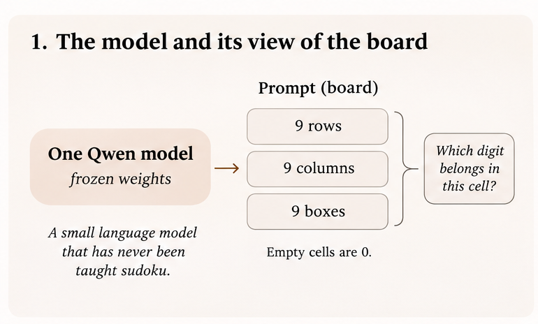
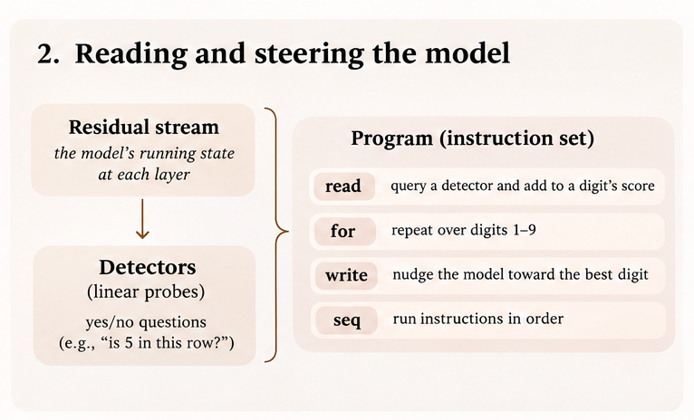
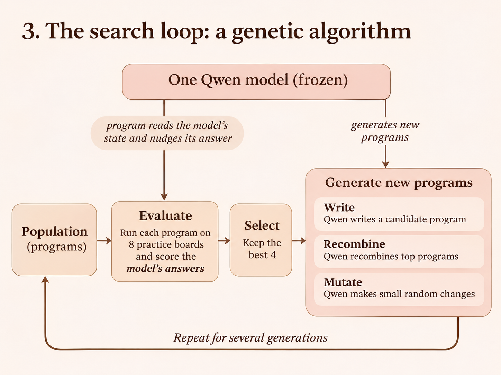
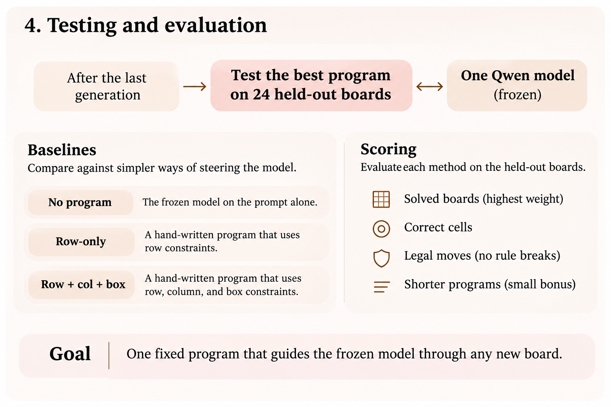

# telepathy

## the model

We use one small language model that has never been taught sudoku. Its weights never change. Everything else in this setup works around it. The same model plays every move and also writes the programs that steer it.

## the prompt

The model sees the board three times over: once as its 9 rows, once as its 9 columns, and once as its 9 boxes. Empty cells show up as zeros. At the very end comes the question: which digit belongs in the cell we care about? The model answers by guessing the next character, and that guess is its move.



## the detectors

As the model reads the prompt, it keeps running notes, a long list of numbers it updates after every character. At the end of each line, its notes sum up that line.

A detector answers one yes-or-no question from those notes, such as "is there already a 5 in this row?" Detectors are built from a sparse autoencoder, a standard interpretability tool. The autoencoder first learns a dictionary of the model's own features from its notes at the end of each line, with no labels (1,024 features per layer, trained on 512 boards). Each detector then picks the 16 features that best separate lines with the digit from lines without it, and sets weights and a threshold on just those. There are 108 detectors: one for each digit, for rows, columns and boxes, at layers 1 to 4. They're built once, on boards the loop never uses, and then frozen.

## the program

The program is a short list of steps, and it has only two kinds of step.

An ask step uses one detector. For example, "is 5 already in this row?" The answer adds to that digit's score. A repeat step can run an ask for every digit from 1 to 9.

A push step nudges the model toward the digit that looks most missing. The nudge goes into the model's notes right before it answers.

The program never sees the board itself. It only sees the detectors' answers.



## the program language

Programs are nested lists with four forms:

```
(seq S ...)          run the steps in order
(for v S ...)        run the steps for v = 1, 2, ..., 9
(read UNIT D LAYER)  is digit D in this cell's ROW, COL or BOX? read at LAYER
(write STRENGTH)     push the model toward the digit that looks most missing
```

Each digit starts with a score of 0. Each `read` adds a detector's answer to that digit's score: positive means present, negative means missing. `write` nudges the model's notes toward the lowest-scoring digit as it answers.

Example: read every digit in the row, column and box, then push.

```
(seq (for v (read ROW v 2) (read COL v 2) (read BOX v 2)) (write 0.10))
```

Rules: layers 1 to 4, strength 0 to 0.5, `v` only inside a `for`, no `for` inside a `for`, at most 12 steps written and 60 run. The search loop edits programs one step at a time and combines pieces of good ones.

## solving a board

We take the first empty cell and show the model the prompt. The program asks its questions and makes its push. The model gives a digit, and we write it into the board, right or wrong. Then we move to the next empty cell, with the updated board, and run the same program again. We stop when every cell is filled.

## finding good programs

We grade each program on a set of practice boards. Fully solved boards count most. Correct cells count next, then moves that break no sudoku rule. Shorter programs get a small bonus.

Each round, we keep the best programs and make new ones in two ways. The same model writes new programs: it tries one, watches it play a few boards cell by cell, and revises it. We also mix pieces of good programs together and make small random changes.



## testing

After several rounds, we test the best program on boards it has never seen. We compare it against no program and against telling the model the rule in words. The goal is one fixed program that guides the frozen model through any new board.



## results

Qwen3-0.6B, 6 generations, 12 programs per generation, scored on 8 practice boards. The latest run uses the autoencoder detectors. The earlier run, with probe detectors fit directly on the model's notes, is shown for comparison.

Boards solved:

| Method | Held-out (24 boards, 2–5 empty) | Hard (12 boards, 10–20 empty) |
| --- | --- | --- |
| No program | 0% | 0% |
| Rule in words | 0% | 0% |
| **Our program, autoencoder detectors (latest)** | **67%** | **0%** |
| Our program, probe detectors (earlier) | 92% | 25% |

Cells right: in the latest run our program gets 85% on held-out and 59% on hard boards, against 97% and 77% with probe detectors. Both baselines stay at 14% or below.

The autoencoder detectors are right about 85% of the time at layer 1, against 95–98% for the probes. That accounts for most of the gap.

**Best program each generation, latest run** (practice boards)

| Generation | Boards solved | Cells right | Where it came from |
| --- | --- | --- | --- |
| 0 | 25% | 41% | random |
| 1 | 63% | 83% | recombined and mutated |
| 2 to 5 | 63% | 89% | written by the model, then recombined and mutated |

Best program, latest run:

```
(seq (for v (read BOX v 1) (read COL v 2)) (for v (read COL v 1)) (read ROW 9 1) (write 0.20))
```

It checks every digit in the box and the column, but only the digit 9 in the row.

In the earlier run, the model wrote the full row, column and box program in generation 0, and it solved all 8 practice boards from generation 1 on:

```
(seq (for v (read BOX v 1) (read COL v 2) (read ROW v 1)) (write 0.34))
```

## todo

- [ ] Writing better programs: steer the model while it writes programs too, not only while it plays
- [ ] Learning how to extract probes: find the reads without fitting a detector for each one

## run

```
./run.sh                    # run, continuing from the last checkpoint if there is one
./run.sh --fresh            # start over
./run.sh --model qwen3-8b   # the bigger model (~16 GB of memory)
```

The first time, `run.sh` sets up Python in `.venv` and installs `requirements.txt`. It uses the Mac's GPU and loads models from the local Hugging Face cache. Settings for the detectors are under `reads` in `config.yaml`.

## files

| File | What it is |
|---|---|
| `run.sh` | Sets up and runs everything. |
| `loop.py` | The loop. Saves a checkpoint as it goes; running again continues where it stopped. |
| `model.py` | The model, loaded once. Runs programs on boards and replies to chats. |
| `write.py` | How the model writes programs: what it is shown, and the write, run, see the trace, revise sessions. |
| `lang.py` | The program language: parse, print, check limits, run, mutate, recombine. |
| `config.yaml` | All settings: model, layers, limits, boards, loop, fitness weights. |
| `sudoku.py` | Boards, a plain solver, board sets saved to files. |
| `sae.py` | The sparse autoencoder, and building a detector from its features: pick the features, then fit weights and a threshold on them. |
